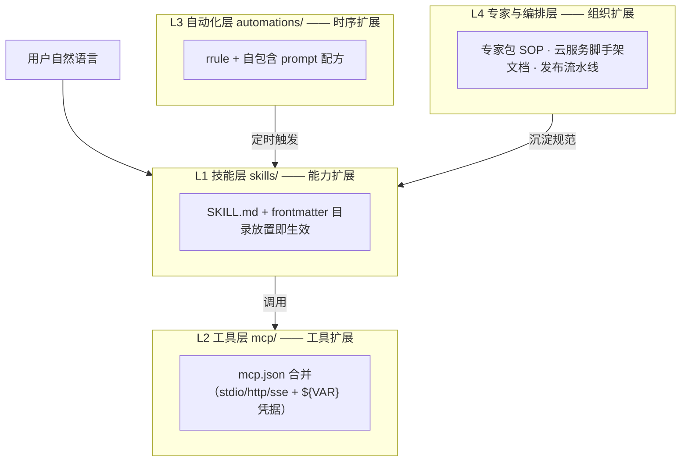

# 四层增强架构（ARCHITECTURE）

> 设计：architect｜日期：2026-10-19｜输入：docs/RESEARCH.md（官方能力+生态）、docs/INVENTORY.md（本机现状）
> 读者：dev（Round 3 施工图在 ASSET-SPEC.md）、社区用户（按图装资产）。标注 `[假设]` 处必经实测验证。

## 0. 总览

每层回答三问：扩展机制是什么 / 接入点在哪 / 本仓库对应资产是什么。

## 1. 技能层（skills/）

- **扩展机制**：目录约定式——`~/.workbuddy/skills/<name>/SKILL.md`，frontmatter 必填 `name`/`description`，运行时按 description 匹配触发。证据：RESEARCH §1（用户级 `~/.workbuddy/skills/` + 内置插件缓存）；INVENTORY §1（本机 4 个用户级技能均为 `SKILL.md + frontmatter（name/description）`）；RESEARCH §2（与 Claude Agent Skills 生态同构，`name` 与目录名一致即该生态约定）。
- **接入点**：无注册表、无安装命令——把 `skills/<pkg>/` 拷入（或软链）`~/.workbuddy/skills/` 即生效；删除目录即卸载。
- **本仓库资产**：`skills/wb-env-doctor`、`skills/wb-skill-auditor`、`skills/wb-mcp-doctor`、`skills/wb-automation-chef`。逐个规格（description 触发词写死、工作流步骤、验收标准）见 ASSET-SPEC.md §1。命中 RESEARCH 差距 #2（开发辅助/自检类技能）。

## 2. 工具层（mcp/）

- **扩展机制**：MCP 服务器写入用户级 `~/.workbuddy/mcp.json`（证据：RESEARCH §1「MCP 服务器（`~/.workbuddy/mcp.json`）」）。schema 采信同厂 CodeBuddy 官方文档《MCP 集成》（cnb.cool/codebuddy/codebuddy-code docs/mcp.md，2026-10-19 访问）：`type=stdio`（`command`/`args`/`env`）、`type=http|sse`（`url`/`headers`）；`env` 与 `headers` 值支持 `${VAR}`、`${VAR:-default}` 展开；未指定 `type` 时按 `command`/`url` 自动推断。`[假设]` WorkBuddy 与 CodeBuddy 同 schema——dev 首步须实测（见 ASSET-SPEC §2 验收）。
- **接入点（本机现状，三处分发）**：用户级 `~/.workbuddy/mcp.json` **不存在**；实际分布于①项目级 `project-resources/*/mcp.json`（wb-issues，已配）、②`~/.mcporter/mcporter.json`（exa，已配）、③内置 MCP 插件（mcp-ardot-mcp-app、mcp-miora）（证据：INVENTORY §2）。补强=统一用户级模板 + 三处机制说明。
- **本仓库资产**：`mcp/mcp.snippets.json`（4 台服务器即抄配置，凭据一律 `${VAR}` 占位）+ `mcp/README.md`（三处分发机制 + 合并操作 + 中文 MCP 社区索引）。命中 RESEARCH 差距 #1、#8。

## 3. 自动化层（automations/）

- **扩展机制**：定时自动化 = rrule + prompt。rrule 方向（本仓 automation 工具参数规范）：`FREQ` 必须显式，支持 `FREQ=DAILY/HOURLY/WEEKLY/MONTHLY/YEARLY` + `BYHOUR/BYMINUTE/BYDAY/BYMONTHDAY/INTERVAL`；一次性用 `scheduledAt`（ISO 8601）。官方层证据：RESEARCH §1「定时自动化（automation，rrule）」。
- **接入点**：自包含 prompt 原则——配方 prompt 必须自带目标、输入（绝对路径）、输出位置、约束、失败处理，不依赖任何对话上下文；触发时无人在场也能跑。官方层空白：RESEARCH §1「自动化无配方库」（差距 #4，本仓库补）。
- **本仓库资产**：`automations/` 下 4 个配方（工作日站会/每周技能审计/每月环境体检/每月 MCP 巡检），配方 = rrule 代码块 + 自包含 prompt 全文 + 创建命令说明。逐个规格见 ASSET-SPEC §3。

## 4. 专家与编排层

- **专家（文档形态）**：专家包结构 = `plugin.json + agents/*.md`（RESEARCH §1 experts 生态 + skill-expert-manager 内置技能）；创建/导入/审查 SOP 复用内置 `skill-expert-manager`（INVENTORY §1）。产出定为文档 SOP（RESEARCH 差距 #6），未在本次三件套内，列入 ROADMAP v0.2，待队长排期。
- **云服务**：RESEARCH 差距 #7 明确「仅出文档建议，代码脚手架走官方」——本节只给选型建议（数据库/存储/认证优先用官方 cloud-service 技能，INVENTORY §1 内置存在），不造轮子。
- **发布流水线**：固化「提交规范 → CI → 版本发布 → 站点部署」四步（INVENTORY §4「发布」行建议）。CI 规格（JSON 校验 + Markdown 链接检查 + frontmatter 检查）见 ASSET-SPEC §4；发布/部署步骤随 v0.2 文档完善。

## 5. 层间关系与使用顺序

社区用户路径：装技能（L1）→ 合并 mcp.snippets.json（L2）→ 按配方建定时任务（L3）→ 参考 SOP 沉淀自己的专家包（L4）。四层资产共同构成 v0.1 交付，退出标准见 ROADMAP.md。

## 6. 待队长决策

1. WorkBuddy 自身 mcp.json schema 官方文档未检索到（workbuddy.cn 无 MCP 页，404 实测）；本设计采信同厂 CodeBuddy 文档并标 `[假设]`——接受此口径，还是 Round 2.5 补官方核实？
2. 专家包 SOP（差距 #6，归属 architect）不在本次三产出内，确认排入 v0.2 并由我继续产出？
